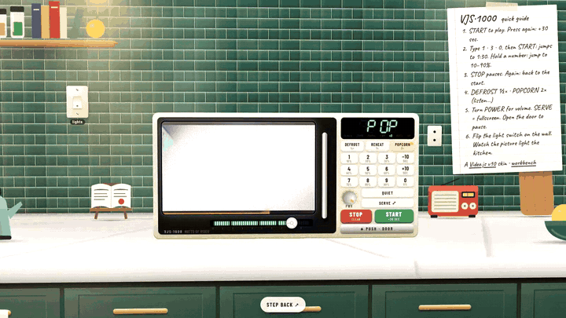
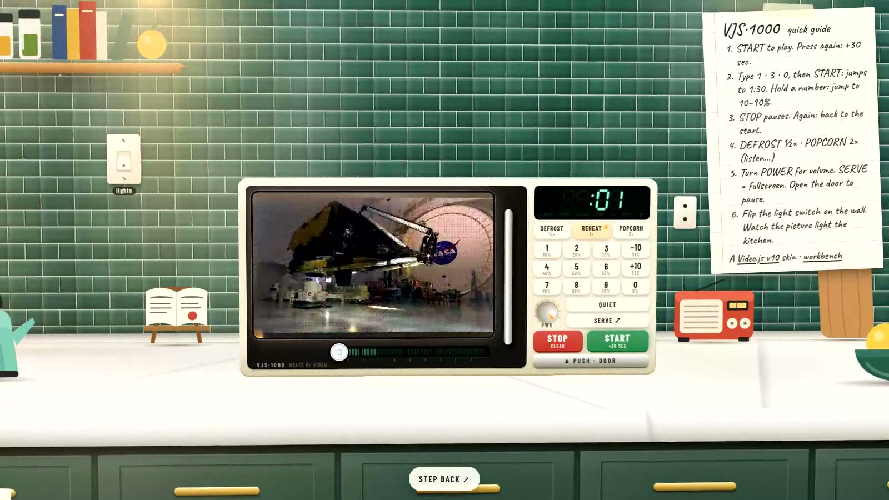
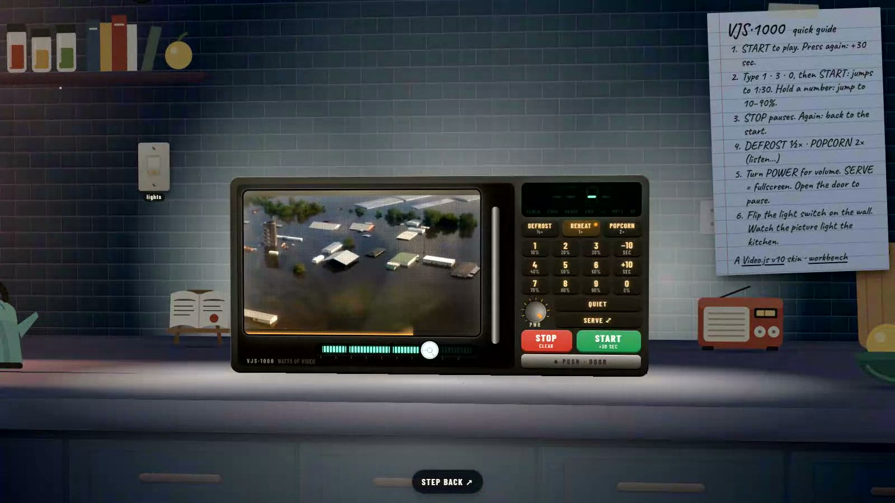
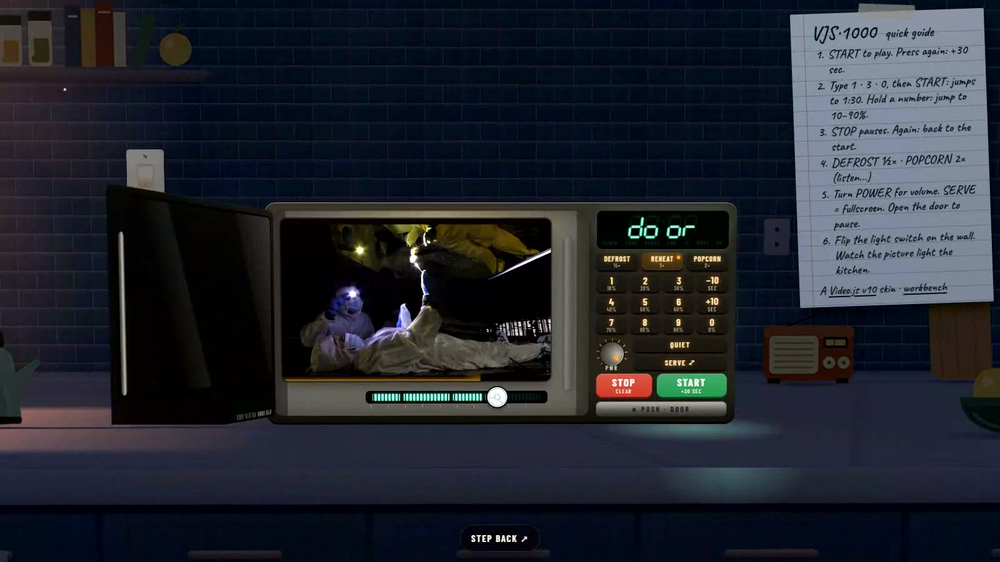
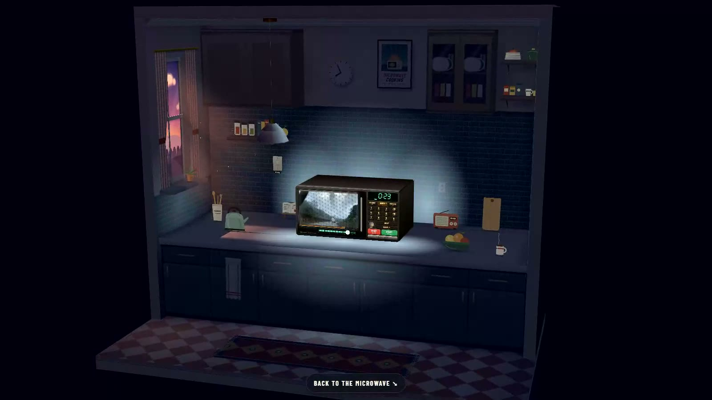

# VJS·1000 — the microwave video player

**A Video.js v10 skin that turns the player into a countertop microwave, sitting in a 3D kitchen you can light up and walk back from.**

Made for the [Contra × Video.js Skins Design Challenge](https://contra.com/community/topic/videojsskinschallenge/guidelines).



| Lights on | Lights off |
| --- | --- |
|  |  |
| **Door open: the paused picture, no mesh** | **Step back: the whole diorama** |
|  |  |

## The idea

Every player has the same five controls. A microwave has them too: you **start** it, **stop** it, punch in a **time**, turn the **power**, and open the **door**. VJS·1000 maps one onto the other, then commits to the bit.

| Microwave | Player |
| --- | --- |
| **START** · press again for **+30 SEC** | Play · skip ahead 30 s |
| **STOP / CLEAR** · press again | Pause · back to the start |
| **Keypad**: tap `1 · 3 · 0`, then START | Jump to 1:30 |
| **Keypad**: hold a number | Jump to that tenth of the video (hold 7 → 70%) |
| **−10 / +10 SEC** | Seek back / forward |
| **DEFROST · REHEAT · POPCORN** | Playback speed ½× · 1× · 2× |
| **POWER** knob | Volume (QUIET mutes) |
| **SERVE ⤢** | Fullscreen, the microwave glides in to fill the screen |
| **⏏ PUSH · DOOR** / the handle | Open the door: pauses, and you see the picture without the glass |
| **Turntable** on the rail | The seek thumb is a little glass plate that spins while it cooks |
| **Display** | Real 7-segment readout: clock, countdown, `do or`, `HE At`, `End`, lamps for COOK / PAUSE / MUTE / speed |

When the video ends it **dings**, beeps three times, and the door pops ajar with a puff of steam.

## The kitchen

The preview page is a CSS-only 3D diorama: walls, cabinets, a dome lamp, a window with the sky for the hour of day, a wall clock set to your time, and a light switch.

- **The light switch is the theme toggle.** Flip it and the kitchen goes dark; the microwave switches to its night look with backlit amber keys, and the picture lights the room in its own colour (sampled from the video, live).
- **Step back ↗** glides the camera out to a three-quarter view of the whole room. Using the microwave brings you back.
- The camera follows your mouse (or your phone's tilt) with a little parallax.

## Built properly

- **Video.js v10 HTML skin.** Built-in parts do the work where they exist: time slider with chapters, preview thumbnails and buffer; volume slider; mute; fullscreen; seek buttons; hotkeys; error dialog; status announcer. The microwave parts (`mw-display`, `mw-keypad`, `mw-start`, `mw-stop`, `mw-door-toggle`, `mw-presets`) are small custom elements that talk to the player store.
- **Keyboard first.** Every control is a real button or slider, in visual order, with a visible focus ring. Type digits on your keyboard to use the keypad; hold a digit to jump; Enter starts, Backspace and Escape clear. Plus Space/K, M, ←/→, J/L, ↑/↓, Home/End, `<` `>` and F.
- **Accessible.** Labelled controls, screen reader announcements, `prefers-reduced-motion` (no orbit, no door swing, instant camera), `forced-colors` support, and both colour schemes.
- **Responsive.** Container queries reflow the panel: side by side on wide players, two columns on tablets, stacked on phones.
- **No images.** The microwave, the display and the kitchen are HTML, CSS and a few SVG paths. Sounds are synthesised with Web Audio.

## Run it

```sh
npm install
npm run dev
```

- `/` is the kitchen.
- `/workbench.html` is the Video.js workbench (sizes, ratios, RTL, languages).
- `/preview.html` is the bare player.

`npm run typecheck` and `npm run build` check and build everything into `dist/`.

### Deploy on Vercel

Import this repo at [vercel.com/new](https://vercel.com/new). `vercel.json` already sets the build (`npm run build`, output `dist`), so you only click **Deploy**.

### Play your own video

Set the source in `apps/preview/src/frame/player.ts`. Any Mux playback ID or HLS URL works:

```ts
const SRC = 'https://stream.mux.com/<PLAYBACK_ID>.m3u8';
const POSTER = 'https://image.mux.com/<PLAYBACK_ID>/thumbnail.webp?time=10';
```

The microwave window takes the shape of the video, so the picture fills the glass with no letterboxing.

## Where things live

- `src/video/skin.html` · `skin.css` · `skin.ts`: the skin.
- `src/video/microwave.ts`: the microwave's custom elements, display, keypad logic and sounds.
- `apps/preview/index.html` + `src/kitchen/`: the 3D kitchen and camera.
- `apps/preview/src/frame/player.ts`: the media the preview plays.

## Credits

- Video: NASA's *Cosmic Dawn* trailer, from the Mux sample library.
- Fonts: [Barlow Condensed](https://fonts.google.com/specimen/Barlow+Condensed) and [Caveat](https://fonts.google.com/specimen/Caveat) via Fontsource.
- Built on [Video.js v10](https://videojs.org).
